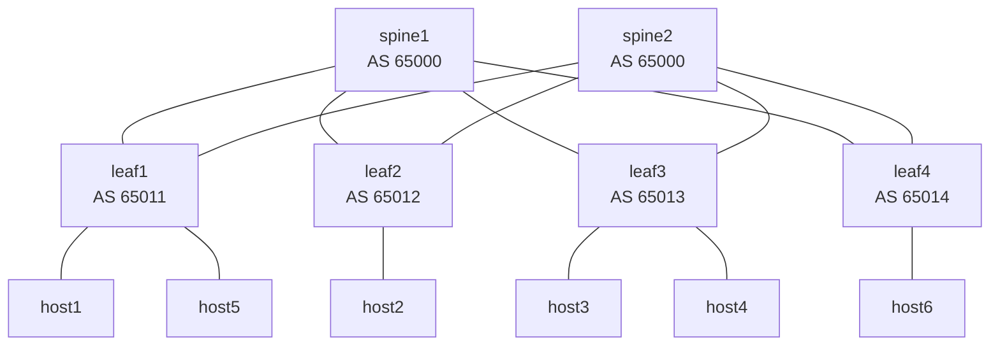

# ai_nop — Data Center Fabric Lab

A containerized **spine–leaf data center fabric** built with [containerlab](https://containerlab.dev) and [FRRouting](https://frrouting.org), whose router configs are generated from a single source of truth with **Nornir + Jinja2** and pushed to the live routers.

> **Current state:** the fabric deploys, routes end to end and passes the reachability test. Render/diff/push automation works for all 6 routers (first iteration).

---

## Table of Contents

1. [What's in the lab](#whats-in-the-lab)
2. [Repository layout](#repository-layout)
3. [Prerequisites](#prerequisites)
4. [Quick start](#quick-start)
5. [Config automation workflow](#config-automation-workflow)
6. [Make targets](#make-targets)
7. [Verifying the fabric](#verifying-the-fabric)
8. [Known quirks](#known-quirks)
9. [Teardown](#teardown)

---

## What's in the lab

### Topology



Each leaf uses `eth1` → spine1 and `eth2` → spine2. Spines use `eth1..eth4` → leaf1..leaf4.

### Addressing and ASNs

| Node   | Role  | ASN   | Loopback   | Host gateway            | Attached hosts                         |
|--------|-------|-------|------------|-------------------------|----------------------------------------|
| spine1 | spine | 65000 | 10.0.0.1   | —                       | —                                      |
| spine2 | spine | 65000 | 10.0.0.2   | —                       | —                                      |
| leaf1  | leaf  | 65011 | 10.0.0.11  | `br0` 192.168.1.1/24    | host1 `.1.10`, host5 `.1.11` (bridged) |
| leaf2  | leaf  | 65012 | 10.0.0.12  | `eth3` 192.168.2.1/24   | host2 `.2.10`                          |
| leaf3  | leaf  | 65013 | 10.0.0.13  | `br0` 192.168.3.1/24    | host3 `.3.10`, host4 `.3.11` (bridged) |
| leaf4  | leaf  | 65014 | 10.0.0.14  | `eth3` 192.168.4.1/24   | host6 `.4.10`                          |

### Routing design

- **eBGP unnumbered** on every fabric link (`neighbor ethX interface remote-as external`) — no point-to-point IPs to manage.
- Each leaf has its own ASN; both spines share AS 65000 (standard RFC 7938 layout).
- **ECMP**: `maximum-paths 4`, plus `bgp bestpath as-path multipath-relax` on leaves so they load-share across both spines.
- `redistribute connected` advertises loopbacks and host subnets.
- Only `zebra` and `bgpd` are enabled (see `daemons`).

### Images

| Nodes            | Image                          |
|------------------|--------------------------------|
| spines, leaves   | `quay.io/frrouting/frr:10.7.1` |
| hosts            | `alpine:latest`                |

---

## Repository layout

```
.
├── dc_lab.clab.yml        # containerlab topology (nodes, links, host IPs, bridges)
├── daemons                # FRR daemons file, bind-mounted into every router
├── configs/               # GENERATED FRR configs, bind-mounted read-only as /etc/frr/frr.conf
├── templates/frr.conf.j2  # Jinja2 template used to generate configs/
├── inventory/             # Nornir SimpleInventory = source of truth
│   ├── hosts.yml          #   per-router data: asn, loopback, fabric_ports, gateway
│   ├── groups.yml         #   spines / leaves → role
│   └── defaults.yml       #   shared data: maximum_paths
├── nornir_config.yml      # Nornir settings (inventory paths, threaded runner)
├── render.py              # inventory + template → configs/*.conf
├── push.py                # diff / apply configs on the running routers via frr-reload.py
├── scripts/reachability.sh# host-to-host ping matrix (exit 1 on any failure)
├── baseline.txt           # sample output of a render + diff run
├── Makefile               # all common commands
├── pyproject.toml, uv.lock, .python-version   # Python 3.12 project managed by uv
└── clab-data_center/      # created by containerlab at deploy time (git-ignored)
```

---

## Prerequisites

| Tool                                         | Why                                   |
|----------------------------------------------|---------------------------------------|
| Linux host (or WSL2 / Linux VM)              | containerlab runs on Linux            |
| [Docker](https://docs.docker.com/engine/install/) | runs the containers              |
| [containerlab](https://containerlab.dev/install/) | deploys the topology             |
| [uv](https://docs.astral.sh/uv/)             | Python env + deps for the automation  |
| `make`, `bash`                               | Makefile and test script              |

Notes:
- containerlab needs root. Either run it with `sudo` (`make deploy CLAB="sudo clab"`) or add your user to the `clab_admins` group.
- Your user must be able to run `docker exec` (be in the `docker` group). `make bgp`, `make test` and `push.py` all depend on it.
- The containers run `apk add tcpdump` at startup, so the routers need internet access on first deploy.

---

## Quick start

```bash
# 1. Clone and enter the repo
git clone <repo-url> ai_nop && cd ai_nop

# 2. Install the Python dependencies (creates .venv/)
uv sync

# 3. Deploy the lab (6 routers + 6 hosts)
make deploy            # or: make deploy CLAB="sudo clab"

# 4. Wait ~10–20 s for BGP to converge, then check it
make bgp               # every neighbor should show a prefix count, not "Active"/"Idle"

# 5. Run the reachability test
make test
```

A healthy fabric prints an all-`ok` matrix:

```
       host1  host2  host3  host4  host5  host6
host1  -      ok     ok     ok     ok     ok
host2  ok     -      ok     ok     ok     ok
...
```

The script exits non-zero if any pair fails, so `make all` (redeploy + test) works as a one-shot check.

---

## Config automation workflow

The files in `configs/` are **generated** — don't edit them by hand. Change the inventory or template and re-render.

```
inventory/*.yml ──┐
                  ├──► render.py ──► configs/<node>.conf ──(bind mount)──► /etc/frr/frr.conf
templates/*.j2 ───┘                                                             │
                                                     push.py ──► frr-reload.py ─┘
                                                     (--test = diff, --reload = apply)
```

| Step | Command        | What it does                                                                                  |
|------|----------------|-----------------------------------------------------------------------------------------------|
| 1    | `make render`  | Runs `render.py`: renders `frr.conf.j2` for every inventory host into `configs/<host>.conf`.  |
| 2    | `make diff`    | Renders, then `push.py` runs `frr-reload.py --test` in each container: shows the lines that would be added/removed vs. the running config. Changes nothing. |
| 3    | `make push`    | Renders, then `push.py --apply` runs `frr-reload.py --reload`: applies the changes live, no container restart. |

Because `configs/` is bind-mounted into the containers, the rendered file is already visible at `/etc/frr/frr.conf` inside each router. `push.py` only has to tell FRR to reload it.

Limit to one router:

```bash
uv run python push.py --node leaf1            # diff leaf1 only
uv run python push.py --node leaf1 --apply    # apply on leaf1 only
```

### Example: adding a leaf

1. Add the node, its links and its hosts in `dc_lab.clab.yml` (bind `configs/leaf5.conf` like the other leaves).
2. Add `leaf5` to `inventory/hosts.yml` (asn, loopback, fabric_ports, gateway) and add the new port to each spine's `fabric_ports`.
3. `make render` → `make redeploy` (new nodes need a redeploy; changes to existing nodes only need `make push`).
4. Add the new hosts to `scripts/reachability.sh` and run `make test`.

---

## Make targets

Run `make` or `make help` for the list.

| Target                       | Description                                         |
|------------------------------|-----------------------------------------------------|
| `make deploy`                | Deploy the lab                                      |
| `make destroy`               | Destroy the lab                                     |
| `make redeploy`              | Deploy with `--reconfigure` (fresh start)           |
| `make test`                  | Run the host reachability matrix                    |
| `make all`                   | `redeploy` + `test`                                 |
| `make inspect`               | List nodes and their management IPs                 |
| `make graph`                 | Serve the topology graph in a browser               |
| `make bgp`                   | `show bgp summary` on all spines and leaves         |
| `make routes NODE=leaf2`     | `show ip route` on a node (default `leaf1`)         |
| `make vtysh NODE=spine1`     | Interactive FRR shell on a node                     |
| `make shell NODE=host3`      | `sh` on any node, hosts included                    |
| `make logs NODE=leaf1`       | Container logs                                      |
| `make edgeshark-up` / `-down`| Install/remove Edgeshark for packet capture         |
| `make clean`                 | Destroy + remove lab artifacts (`--cleanup`)        |
| `make render`                | Generate `configs/` from inventory + template       |
| `make diff`                  | Render + show the diff against running routers      |
| `make push`                  | Render + apply the configs live                     |

> `render`, `diff` and `push` are not yet listed in `make help`.

---

## Verifying the fabric

```bash
make bgp                                  # all sessions Established
make routes NODE=leaf1                    # 192.168.2/3/4.0/24 with two next hops (ECMP)
docker exec clab-data_center-host1 traceroute 192.168.4.10   # host1 → leaf1 → spine → leaf4 → host6
```

To capture traffic on a router: `docker exec -it clab-data_center-spine1 tcpdump -ni eth1`, or use Edgeshark (`make edgeshark-up`).

---

## Known quirks

- **`make diff` is never fully empty.** As `baseline.txt` shows, `frr-reload.py --test` reports a `bgp deterministic-med` delete and `no bgp ebgp-requires-policy` / `service integrated-vtysh-config` adds on every router, even right after a push. This comes from how `frr defaults datacenter` sets implicit defaults, which the reload script's diff doesn't account for. It's harmless; real changes show up alongside it.
- **Config files are mounted read-only.** Edit inputs on the host and re-render; changes made inside a container with `write memory` won't survive.
- **Host IPs and bridges** (`br0` on leaf1/leaf3) are set up by `exec` commands in `dc_lab.clab.yml`, not by the automation. They are lost if a container restarts outside of containerlab.
- `src/` is empty and `__pycache__/` is a local artifact. The Python entry points are `render.py` and `push.py` at the repo root.

---

## Teardown

```bash
make destroy    # stop and remove the containers
make clean      # same, plus delete the clab-data_center/ directory
```
