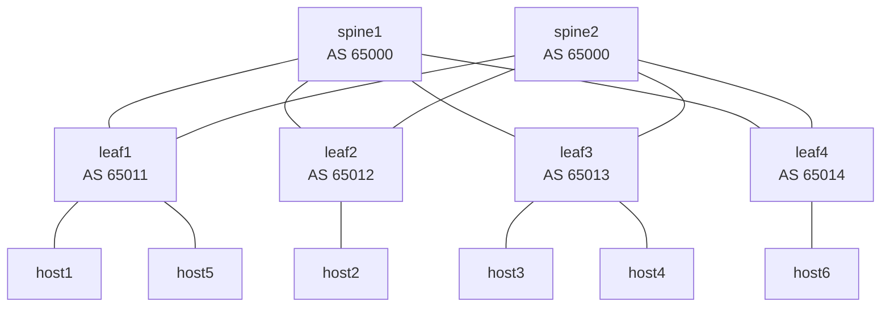

# ai_nop — Data Center Fabric Lab

A containerized **spine–leaf data center fabric** built with [containerlab](https://containerlab.dev) and [FRRouting](https://frrouting.org), whose router configs are generated from a single source of truth with **Nornir + Jinja2** and pushed to the live routers. An **observability stack** (Prometheus, Grafana, Loki, Alloy, Alertmanager) collects metrics and logs from every router.

> **Current state:** the fabric deploys, routes end to end and passes the reachability test. Render/diff/push automation works for all 6 routers. Every router exports BGP and interface metrics plus its FRR logs, and a provisioned Grafana dashboard shows fabric health, BGP state, link traffic and logs on one screen.

---

## Table of Contents

1. [What's in the lab](#whats-in-the-lab)
2. [Repository layout](#repository-layout)
3. [Prerequisites](#prerequisites)
4. [Quick start](#quick-start)
5. [Config automation workflow](#config-automation-workflow)
6. [Observability](#observability)
7. [Make targets](#make-targets)
8. [Verifying the fabric](#verifying-the-fabric)
9. [Known quirks](#known-quirks)
10. [Teardown](#teardown)

---

## What's in the lab

### Topology



Each leaf uses `eth1` → spine1 and `eth2` → spine2. Spines use `eth1..eth4` → leaf1..leaf4.

### Addressing and ASNs

| Node   | Role  | ASN   | Loopback   | Host gateway            | Attached hosts                         |
|--------|-------|-------|------------|-------------------------|----------------------------------------|
| spine1 | spine | 65000 | 10.0.0.1   | —                       | —                                      |
| spine2 | spine | 65000 | 10.0.0.2   | —                       | —                                      |
| leaf1  | leaf  | 65011 | 10.0.0.11  | `br0` 192.168.1.1/24    | host1 `.1.10`, host5 `.1.11` (bridged) |
| leaf2  | leaf  | 65012 | 10.0.0.12  | `eth3` 192.168.2.1/24   | host2 `.2.10`                          |
| leaf3  | leaf  | 65013 | 10.0.0.13  | `br0` 192.168.3.1/24    | host3 `.3.10`, host4 `.3.11` (bridged) |
| leaf4  | leaf  | 65014 | 10.0.0.14  | `eth3` 192.168.4.1/24   | host6 `.4.10`                          |

### Routing design

- **eBGP unnumbered** on every fabric link (`neighbor ethX interface remote-as external`) — no point-to-point IPs to manage.
- Each leaf has its own ASN; both spines share AS 65000 (standard RFC 7938 layout).
- **ECMP**: `maximum-paths 4`, plus `bgp bestpath as-path multipath-relax` on leaves so they load-share across both spines.
- `redistribute connected` advertises loopbacks and host subnets.
- Only `zebra` and `bgpd` are enabled (see `daemons`).

### Images

| Nodes            | Image                          |
|------------------|--------------------------------|
| spines, leaves   | `quay.io/frrouting/frr:10.7.1` |
| hosts            | `alpine:latest`                |

Observability images are pinned in `observability/compose.yml`: Prometheus v3.15.0, Alertmanager v0.34.1, Loki 3.7.8, Alloy v1.21.0, Grafana 13.2.4. The exporters run as binaries inside the routers: `frr_exporter` 1.12.0 and `node_exporter` 1.12.1 (versions set in the `Makefile`).

---

## Repository layout

```
.
├── dc_lab.clab.yml        # containerlab topology (nodes, links, host IPs, bridges)
├── daemons                # FRR daemons file, bind-mounted into every router
├── configs/               # GENERATED FRR configs, bind-mounted read-only as /etc/frr/frr.conf
├── templates/frr.conf.j2  # Jinja2 template used to generate configs/
├── inventory/             # Nornir SimpleInventory = source of truth
│   ├── hosts.yml          #   per-router data: asn, loopback, fabric_ports, gateway
│   ├── groups.yml         #   spines / leaves → role
│   └── defaults.yml       #   shared data: maximum_paths
├── nornir_config.yml      # Nornir settings (inventory paths, threaded runner)
├── render.py              # inventory + template → configs/*.conf
├── push.py                # diff / apply configs on the running routers via frr-reload.py
├── render_targets.py      # inventory → observability/prometheus/targets/*.yml
├── observability/         # monitoring stack (docker compose)
│   ├── compose.yml        #   Prometheus, Alertmanager, Loki, Alloy, Grafana on the clab network
│   ├── prometheus/        #   prometheus.yml, rules/, targets/ (GENERATED by render_targets.py)
│   ├── alertmanager/      #   alertmanager.yml
│   ├── alloy/config.alloy #   tails logs/<node>/frr.log and ships it to Loki
│   └── grafana/           #   provisioning/ (datasources, dashboard provider) + dashboards/fabric.json
├── bin/                   # exporter binaries, downloaded by `make exporters` (git-ignored)
├── logs/<node>/           # FRR log files, bind-mounted from each router (git-ignored)
├── scripts/reachability.sh# host-to-host ping matrix (exit 1 on any failure)
├── baseline.txt           # sample output of a render + diff run
├── Makefile               # all common commands
├── pyproject.toml, uv.lock, .python-version   # Python 3.12 project managed by uv
└── clab-data_center/      # created by containerlab at deploy time (git-ignored)
```

---

## Prerequisites

| Tool                                         | Why                                   |
|----------------------------------------------|---------------------------------------|
| Linux host (or WSL2 / Linux VM)              | containerlab runs on Linux            |
| [Docker](https://docs.docker.com/engine/install/) | runs the containers              |
| [containerlab](https://containerlab.dev/install/) | deploys the topology             |
| [uv](https://docs.astral.sh/uv/)             | Python env + deps for the automation  |
| `make`, `bash`                               | Makefile and test script              |

Notes:
- containerlab needs root. Either run it with `sudo` (`make deploy CLAB="sudo clab"`) or add your user to the `clab_admins` group.
- Your user must be able to run `docker exec` (be in the `docker` group). `make bgp`, `make test` and `push.py` all depend on it.
- The containers run `apk add tcpdump` at startup, so the routers need internet access on first deploy.
- The first `make deploy` downloads the exporter binaries from GitHub with `curl`.
- The observability stack uses [Docker Compose v2](https://docs.docker.com/compose/) (`docker compose`) and publishes ports 3000, 3100, 9090, 9093 and 12345 on the host, so those must be free.

---

## Quick start

```bash
# 1. Clone and enter the repo
git clone <repo-url> ai_nop && cd ai_nop

# 2. Install the Python dependencies (creates .venv/)
uv sync

# 3. Deploy the lab (6 routers + 6 hosts)
#    also downloads the exporters into bin/ and creates logs/<node>/
make deploy            # or: make deploy CLAB="sudo clab"

# 4. Wait ~10–20 s for BGP to converge, then check it
make bgp               # every neighbor should show a prefix count, not "Active"/"Idle"

# 5. Run the reachability test
make test
```

A healthy fabric prints an all-`ok` matrix:

```
       host1  host2  host3  host4  host5  host6
host1  -      ok     ok     ok     ok     ok
host2  ok     -      ok     ok     ok     ok
...
```

The script exits non-zero if any pair fails, so `make all` (redeploy + test) works as a one-shot check.

```bash
# 6. Start the observability stack (the lab must be deployed first, see below)
make obs-up

# 7. Open Grafana → Dashboards → NetOps Lab → Fabric Overview
xdg-open http://localhost:3000/d/fabric-overview/fabric-overview
```

---

## Config automation workflow

The files in `configs/` are **generated** — don't edit them by hand. Change the inventory or template and re-render.

```
inventory/*.yml ──┐
                  ├──► render.py ──► configs/<node>.conf ──(bind mount)──► /etc/frr/frr.conf
templates/*.j2 ───┘                                                             │
                                                     push.py ──► frr-reload.py ─┘
                                                     (--test = diff, --reload = apply)
```

| Step | Command        | What it does                                                                                  |
|------|----------------|-----------------------------------------------------------------------------------------------|
| 1    | `make render`  | Runs `render.py`: renders `frr.conf.j2` for every inventory host into `configs/<host>.conf`.  |
| 2    | `make diff`    | Renders, then `push.py` runs `frr-reload.py --test` in each container: shows the lines that would be added/removed vs. the running config. Changes nothing. |
| 3    | `make push`    | Renders, then `push.py --apply` runs `frr-reload.py --reload`: applies the changes live, no container restart. |

Because `configs/` is bind-mounted into the containers, the rendered file is already visible at `/etc/frr/frr.conf` inside each router. `push.py` only has to tell FRR to reload it.

Limit to one router:

```bash
uv run python push.py --node leaf1            # diff leaf1 only
uv run python push.py --node leaf1 --apply    # apply on leaf1 only
```

### Example: adding a leaf

1. Add the node, its links and its hosts in `dc_lab.clab.yml` (bind `configs/leaf5.conf` like the other leaves).
2. Add `leaf5` to `inventory/hosts.yml` (asn, loopback, fabric_ports, gateway) and add the new port to each spine's `fabric_ports`.
3. `make render` → `make redeploy` (new nodes need a redeploy; changes to existing nodes only need `make push`).
4. Add the new hosts to `scripts/reachability.sh` and run `make test`.

---

## Observability

### How it fits together

```
 each router (spine1..leaf4)                       observability/compose.yml  (project "obs")
┌──────────────────────────────┐
│ frr_exporter  :9342  BGP, RIB │◄──── scrape every 5s ──── Prometheus :9090 ──► Alertmanager :9093
│ node_exporter :9100  ifaces   │                               │
│ /var/log/frr/frr.log ─────────┼─► logs/<node>/frr.log ◄── Alloy :12345 ──► Loki :3100
└──────────────────────────────┘     (bind mount)                │                 │
                                                                  └──── Grafana :3000 ┘
```

- **Metrics.** `make deploy` downloads `frr_exporter` and `node_exporter` into `bin/`. `dc_lab.clab.yml` bind-mounts them into every router and starts them with `exec`. `frr_exporter` runs with the OSPF and BFD collectors disabled, since neither daemon is enabled. `node_exporter` only runs the `netdev` and `netclass` collectors.
- **Scrape targets come from the inventory.** `render_targets.py` (`make targets`) reads `inventory/` with Nornir and writes `observability/prometheus/targets/{frr,node}.yml`. Every target carries `node`, `role` and `asn` labels. Prometheus reads these files through `file_sd_configs`, so adding a router to the inventory and running `make targets` is enough; no Prometheus restart is needed. `make render` and `make obs-up` both run `make targets` first.
- **Logs.** The template sets `log file /var/log/frr/frr.log informational` with millisecond timestamps. Each router's `/var/log/frr` is bind-mounted to `logs/<node>/`, and Alloy tails `logs/*/frr.log` and pushes the lines to Loki with `job="frr"` and a `node` label taken from the path.
- **Networking.** The compose services join the existing `clab` Docker network that containerlab creates, which is why the lab has to be deployed before `make obs-up`. On that network Prometheus reaches the routers by container name (`clab-data_center-leaf1:9342`).
- **Grafana** is provisioned from files: the Prometheus (`uid: prom`), Loki (`uid: loki`) and Alertmanager (`uid: am`) datasources and a dashboard provider that loads every `.json` in `observability/grafana/dashboards/` into the **NetOps Lab** folder. Anonymous access is enabled with the Admin role, so there is no login (lab only).

### Running it

```bash
make deploy      # lab first: creates the clab network, logs/ and bin/
make obs-up      # renders the targets, then docker compose up -d
make obs-down    # stop the stack; metrics, logs and Grafana state stay in Docker volumes
```

To wipe the stored data too: `docker compose -f observability/compose.yml down -v`.

| UI           | URL                                               | Use it for                                    |
|--------------|---------------------------------------------------|-----------------------------------------------|
| Grafana      | http://localhost:3000/d/fabric-overview/fabric-overview | Fabric Overview dashboard, Explore (PromQL / LogQL) |
| Prometheus   | http://localhost:9090/targets                     | All 12 targets (6 × `frr`, 6 × `node`) should be **UP** |
| Alertmanager | http://localhost:9093                             | Active alerts                                 |
| Alloy        | http://localhost:12345                            | Log pipeline graph and component health       |
| Loki         | http://localhost:3100/ready                       | API only; browse logs from Grafana            |

Prometheus is started with `--web.enable-lifecycle`, so after editing `prometheus.yml` or a rule file you can reload it without a restart:

```bash
curl -X POST localhost:9090/-/reload
```

### The Fabric Overview dashboard

The panels are grouped into rows that each answer one question. Crosshairs are shared across panels, the default range is the last hour with a 10 s refresh, and a **Node** filter at the top applies to every panel.

| Row | Panels |
|-----|--------|
| **Health** | Tiles that are green at 0 (or 100 %) and turn red/orange otherwise: % of BGP sessions established, sessions not established, session resets in the time range, fabric ports down, scrape targets down, `ADJCHANGE` log events in the time range |
| **BGP control plane** | Session state over time (one row per session, red when down), prefixes received per session, IPv4 routes in the RIB per node |
| **Fabric links** | Throughput of the 8 leaf–spine links measured on the leaf side (leaf → spine above zero, spine → leaf below), fabric port state over time, drops + errors per interface |
| **Logs** | FRR log volume per node and the raw FRR logs |

A failure shows up in every row at the same time, so you can read it top to bottom. To try it, take a link down and watch the dashboard:

```bash
docker exec clab-data_center-leaf1 ip link set eth1 down    # break leaf1 ↔ spine1
docker exec clab-data_center-leaf1 ip link set eth1 up      # restore it
```

If you zoom into a graph, the dashboard switches to a fixed time range and stops following live data. Pick **Last 1 hour** in the time picker (or press `Ctrl+Z`) to go back.

### Editing the dashboard

`observability/grafana/dashboards/fabric.json` is the source of truth; Grafana re-reads the folder about every 10 s.

1. Edit the dashboard in the Grafana UI.
2. **Export → Export as JSON** and **overwrite** `fabric.json`. Keep `metadata.name` as `fabric-overview`.
3. Don't save extra exports into `dashboards/`, and don't import the file through **Dashboards → Import**. Two files with the same `metadata.name` make Grafana stop updating the whole folder (`the same UID is used more than once` in `docker logs obs-grafana-1`). If that happens, remove the duplicates and run `docker restart obs-grafana-1`.

---

## Make targets

Run `make` or `make help` for the list.

| Target                       | Description                                         |
|------------------------------|-----------------------------------------------------|
| `make deploy`                | Deploy the lab                                      |
| `make destroy`               | Destroy the lab                                     |
| `make redeploy`              | Deploy with `--reconfigure` (fresh start)           |
| `make test`                  | Run the host reachability matrix                    |
| `make all`                   | `redeploy` + `test`                                 |
| `make inspect`               | List nodes and their management IPs                 |
| `make graph`                 | Serve the topology graph in a browser               |
| `make bgp`                   | `show bgp summary` on all spines and leaves         |
| `make routes NODE=leaf2`     | `show ip route` on a node (default `leaf1`)         |
| `make vtysh NODE=spine1`     | Interactive FRR shell on a node                     |
| `make shell NODE=host3`      | `sh` on any node, hosts included                    |
| `make logs NODE=leaf1`       | Container logs                                      |
| `make edgeshark-up` / `-down`| Install/remove Edgeshark for packet capture         |
| `make clean`                 | Destroy + remove lab artifacts (`--cleanup`)        |
| `make render`                | Generate `configs/` from inventory + template       |
| `make diff`                  | Render + show the diff against running routers      |
| `make push`                  | Render + apply the configs live                     |
| `make exporters`             | Download `frr_exporter` and `node_exporter` into `bin/` (run by `deploy`) |
| `make logdirs`               | Create `logs/<node>/` for the FRR log files (run by `deploy`) |
| `make targets`               | Generate the Prometheus targets from the inventory  |
| `make obs-up`                | `targets` + start the observability stack           |
| `make obs-down`              | Stop the observability stack                        |

---

## Verifying the fabric

```bash
make bgp                                  # all sessions Established
make routes NODE=leaf1                    # 192.168.2/3/4.0/24 with two next hops (ECMP)
docker exec clab-data_center-host1 traceroute 192.168.4.10   # host1 → leaf1 → spine → leaf4 → host6
```

To capture traffic on a router: `docker exec -it clab-data_center-spine1 tcpdump -ni eth1`, or use Edgeshark (`make edgeshark-up`).

---

## Known quirks

- **`make diff` is never fully empty.** As `baseline.txt` shows, `frr-reload.py --test` reports a `bgp deterministic-med` delete and `no bgp ebgp-requires-policy` / `service integrated-vtysh-config` adds on every router, even right after a push. This comes from how `frr defaults datacenter` sets implicit defaults, which the reload script's diff doesn't account for. It's harmless; real changes show up alongside it.
- **Config files are mounted read-only.** Edit inputs on the host and re-render; changes made inside a container with `write memory` won't survive.
- **Host IPs and bridges** (`br0` on leaf1/leaf3) are set up by `exec` commands in `dc_lab.clab.yml`, not by the automation. They are lost if a container restarts outside of containerlab.
- **The exporters are started with `nohup` from `exec`.** If a router container restarts outside of containerlab they don't come back; run `make redeploy`.
- **`logs/` is world-writable** (`chmod 777`) because FRR writes as uid 100 inside the container, and the log files are mode 600. Alloy can read them because it runs as root in its container (lab only).
- **Log timestamps in Loki are the time Alloy read the line**, not the timestamp FRR wrote (FRR writes UTC). They are usually within a second of each other.
- **No alert rules yet.** `observability/prometheus/rules/fabric.yml` is loaded but empty, and the Alertmanager `default` receiver has no notification channel.
- `src/` is empty and `__pycache__/` is a local artifact. The Python entry points are `render.py`, `push.py` and `render_targets.py` at the repo root.

---

## Teardown

```bash
make obs-down   # stop the observability stack first (it is attached to the clab network)
make destroy    # stop and remove the containers
make clean      # same, plus delete the clab-data_center/ directory
```
